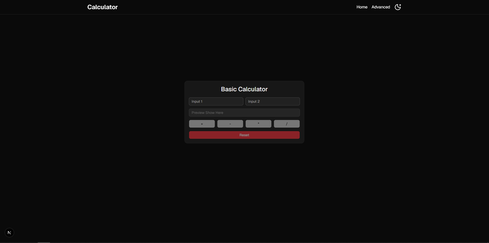
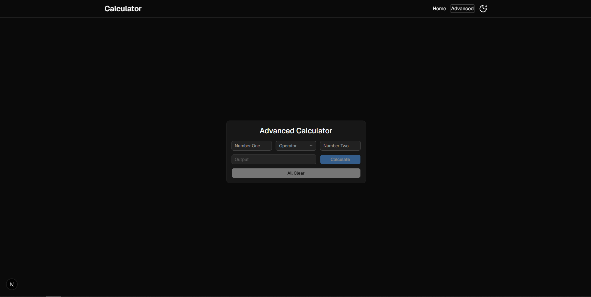

<p align="center">
  
</p>

<h1 align="center">Modern Calculator App with Next.js</h1>

<p align="center"><strong>A fast, minimalist, and responsive dual-mode calculator for the web.</strong></p>

<p align="center">
  Perform instant calculations with ease.<br />
  A clean calculator application featuring Basic and Advanced modes built with Next.js, React 19, TypeScript, and Tailwind CSS.
</p>

<p align="center">
  
  
  
  
  
</p>

<p align="center">
  <a href="#screenshots">Screenshots</a> · 
  <a href="#features">Features</a> · 
  <a href="#technology-stack">Tech Stack</a> · 
  <a href="#getting-started">Getting Started</a> · 
  <a href="#available-scripts">Scripts</a> · 
  <a href="#author">Author</a>
</p>

<br />

<p align="center">
  <a href="https://github.com/piyushsarkar-dev/calculator-app">
    
  </a>
</p>

<p align="center"><sub>Seamless arithmetic operations with light and dark mode support.</sub></p>

---

## Overview

**Calculator App** is a fast, responsive, and beautifully designed web application developed with **Next.js 16 (App Router)**, **React 19**, and **TypeScript**. It offers two tailored calculation experiences:

1. **Basic Calculator (`/`)**: A fast two-number instant calculator with dedicated operation buttons (`+`, `-`, `*`, `/`) and a reset feature.
2. **Advanced Calculator (`/advanced`)**: A flexible calculation workflow using an operator dropdown selector, an explicit calculate trigger, and complete state clearing (`All Clear`).

Both interfaces are styled using **Tailwind CSS 4** and accessible primitives powered by **Base UI** and **shadcn/ui**, accompanied by dark/light theme switching with smooth transitions.

### What you can learn from this project

- Building fast, type-safe interactive components in **React 19** and **Next.js 16**.
- Managing client-side state for mathematical input and validation.
- Handling edge cases in math operations (e.g. division by zero, empty inputs, disabled states).
- Implementing theme persistence using `next-themes`.
- Structuring modular and scalable UI primitives with Tailwind CSS 4 and Base UI.

---

## Features

- **Dual Calculator Experiences**:
  - **Basic Mode**: Quick arithmetic with real-time button triggers.
  - **Advanced Mode**: Operator dropdown select (`+`, `-`, `*`, `/`) with dedicated `Calculate` and `All Clear` workflows.
- **Robust Error Handling**: Gracefully handles division by zero (`Cannot divide by zero`) and input boundary conditions.
- **Smart Button Validation**: Prevents invalid operations by dynamically disabling buttons when inputs are missing.
- **Light & Dark Theme Toggle**: Integrated `next-themes` support with smooth transition across all components.
- **Accessible & Modern UI**: Built with accessible Base UI primitives and styled with modern Tailwind CSS utilities.
- **Fully Responsive**: Optimized for desktops, tablets, and mobile devices with clean typography and spacing.

---

## Screenshots

Explore the application interfaces below. Click any image to view it in full resolution.

### 01 · Basic Calculator

The default view designed for fast, two-input arithmetic with direct action buttons and instant result preview.

<p align="center">
  <a href="./public/basi-cal-img.png">
    
  </a>
  <br />
  <sub>Basic Calculator interface with quick operation triggers.</sub>
</p>

### 02 · Advanced Calculator

The advanced view featuring custom operator selection, calculate action, and full state reset.

<p align="center">
  <a href="./public/adv-cal-img.png">
    
  </a>
  <br />
  <sub>Advanced Calculator interface with select operator dropdown and dedicated actions.</sub>
</p>

---

## Technology Stack

| Area | Technologies |
| :--- | :--- |
| **Framework** | Next.js 16 (App Router), React 19, TypeScript 6 |
| **Styling** | Tailwind CSS 4.2, PostCSS, `tw-animate-css` |
| **UI Primitives** | Base UI (`@base-ui/react`), shadcn/ui design patterns |
| **Icons & Theme** | Lucide React, `next-themes` |
| **Utilities** | `clsx`, `tailwind-merge`, `class-variance-authority` |
| **Tooling & Linter** | ESLint 9, Prettier with Tailwind CSS plugin |

*Dependencies and version ranges reflect declarations in [`package.json`](./package.json).*

---

## Project Structure

```text
calculator-app/
├── public/
│   ├── adv-cal-img.png        # Advanced calculator preview image
│   ├── basi-cal-img.png       # Basic calculator preview image
│   └── favicon.ico            # Application icon
├── src/
│   ├── app/
│   │   ├── advanced/
│   │   │   └── page.tsx       # Advanced calculator route (/advanced)
│   │   ├── globals.css        # Global CSS & Tailwind configuration
│   │   ├── layout.tsx         # Root layout with Header & ThemeProvider
│   │   └── page.tsx           # Basic calculator route (/)
│   ├── components/
│   │   ├── Header/
│   │   │   └── Header.tsx     # Navigation bar & theme switcher
│   │   ├── Providers/
│   │   │   └── ThemeProvider.tsx # Theme context provider
│   │   ├── shadcnui/          # Reusable UI primitives (Button, Input, Select, Card)
│   │   ├── AdvancedCalculator.tsx # Advanced calculator state & logic
│   │   ├── BasicCalculator.tsx    # Basic calculator state & logic
│   │   └── ThemeToggleButton.tsx  # Theme toggle component
│   └── lib/
│       ├── fonts.ts           # Typography & font declarations
│       └── utils.ts           # Class merge (cn) helper
├── package.json
└── tsconfig.json
```

---

## Getting Started

### Prerequisites

- **Node.js**: `v24.x` or newer
- **npm**: `v11.x` or newer

### Installation

1. **Clone the repository:**

   ```sh
   git clone https://github.com/piyushsarkar-dev/calculator-app.git
   cd calculator-app
   ```

2. **Install dependencies:**

   ```sh
   npm install
   ```

3. **Start the development server:**

   ```sh
   npm run dev
   ```

4. **Open in browser:**

   Navigate to [http://localhost:3000](http://localhost:3000) to view the application.

---

## Available Scripts

| Command | Purpose |
| :--- | :--- |
| `npm run dev` | Starts the Next.js development server at `localhost:3000`. |
| `npm run build` | Builds an optimized production bundle of the application. |
| `npm run start` | Runs the compiled production build locally. |
| `npm run lint` | Runs ESLint to check for code quality and formatting issues. |
| `npm run prod` | Sequentially runs linter, builds the app, and starts production server. |

---

## Calculator Workflows

### Basic Calculator Workflow

1. **Enter values**: Fill in **Input 1** and **Input 2** with your target numbers.
2. **Choose operation**: Click any operator button (`+`, `-`, `*`, `/`).
3. **View result**: The calculated result is shown immediately in the **Preview Show Here** field.
4. **Reset**: Click **Reset** to clear all inputs and output values.

### Advanced Calculator Workflow

1. **Enter first number**: Type the value in the **Number One** field.
2. **Pick an operator**: Open the **Operator** dropdown and select `+`, `-`, `*`, or `/`.
3. **Enter second number**: Type the value in the **Number Two** field.
4. **Compute**: Click the **Calculate** button to evaluate the result.
5. **Clear**: Click **All Clear** to reset inputs, operator, and the result display.

---

## Future Improvements

- [ ] Add scientific calculation functions (square root, power, trigonometry, logarithm).
- [ ] Implement history log with local storage persistence.
- [ ] Keyboard shortcut navigation and number pad listeners.
- [ ] Sound/haptic feedback on button presses.

---

## License

This project is licensed under the **MIT License**. See the [LICENSE](./LICENSE) file for complete details.

---

<p align="center">
  <em>“Every small project is a step toward building something meaningful.”</em>
</p>

<div id="author" align="center">
  <a href="https://github.com/piyushsarkar-dev">
    
  </a>
  <br />
  <strong>Author: <a href="https://github.com/piyushsarkar-dev">Piyush Sarkar</a></strong><br />
  <sub>Built with curiosity, care, and a passion for modern web technologies.</sub>
  <br /><br />
  <a href="https://github.com/piyushsarkar-dev">
    
  </a>
  <a href="mailto:hi.mrpiyush@gmail.com">
    
  </a>
  <a href="https://github.com/piyushsarkar-dev/calculator-app">
    
  </a>
</div>
